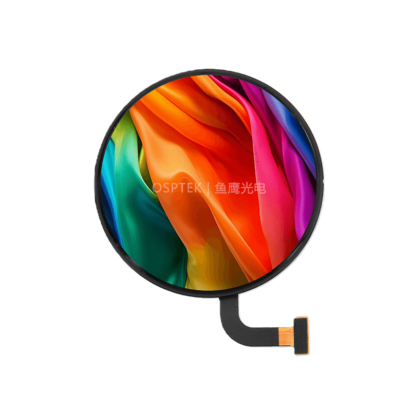

<p align="left"></p>

<h1 align="center">OSPTEK 1.73″ AMOLED 显示屏 466×466（AM173M466466FLS2）</h1>

<p align="center"><b>AMOLED 模组 · MIPI · CO5300</b></p>

<p align="center"><a href="./README_EN.md">English</a> | 简体中文 · <a href="../../README.md">规格族索引</a></p>

<p align="center">
  
  
  
</p>

<p align="center"></p>

## 目录

- [规格参数](#规格参数)
- [相关资料](#相关资料)
- [仓库结构](#仓库结构)
- [购买链接](#购买链接)
- [技术支持](#技术支持)

---

## 规格参数

| 项目 | 规格 |
| ---- | ---- |
| 尺寸 | 1.73 英寸 |
| 类型 | AMOLED |
| 分辨率 | 466×466 |
| 外形尺寸 | 50.00 x 50.00 x 2.06 mm |
| 有效显示区域 | Φ43.76 mm |
| 接口 | MIPI |
| 驱动 IC | CO5300 |
| 触摸驱动 | CST9217 |

> 完整外形尺寸、FPC 定义、供电与时序以产品规格书 / 驱动手册为准。

## 相关资料

| 分类 | 文件 |
| ---- | ---- |
| 规格文档 | [`CO_5300_Datasheet_V0_00_20230328_07edb82936.pdf`](./datasheets/CO_5300_Datasheet_V0_00_20230328_07edb82936.pdf) |
| 规格文档 | [`AM173M466466FLS2.pdf`](./datasheets/AM173M466466FLS2.pdf) |
| CAD 图纸 | [`1.73寸AMOLED转接板.step`](./cad/1.73%E5%AF%B8AMOLED%E8%BD%AC%E6%8E%A5%E6%9D%BF.step) |
| CAD 图纸 | [`AM173M466466FLS2.dwg`](./cad/AM173M466466FLS2.dwg) |
| CAD 图纸 | [`AM173M466466FLS2_外形图.pdf`](./cad/AM173M466466FLS2_%E5%A4%96%E5%BD%A2%E5%9B%BE.pdf) |
| CAD 图纸 | [`OK-14F024-04.pdf`](./cad/OK-14F024-04.pdf) |
| 转接板资料 | [`1.73寸AMOLED转接板原理图.png`](./adapter/1.73%E5%AF%B8AMOLED%E8%BD%AC%E6%8E%A5%E6%9D%BF%E5%8E%9F%E7%90%86%E5%9B%BE.png) |
| 转接板资料 | [`PCB-1.73寸AMOLED屏MIPI转接板V2.0.pdf`](./adapter/PCB-1.73%E5%AF%B8AMOLED%E5%B1%8FMIPI%E8%BD%AC%E6%8E%A5%E6%9D%BFV2.0.pdf) |

## 仓库结构

```text
display-amoled-1.73inch-466x466/ # 仓库根（导航见 ../../README.md，示例工程见根目录 examples/）
└── versions/
    └── AM173M466466FLS2/        # 本料号完整资料
        ├── README.md
        ├── README_EN.md
        ├── osptek.yml
        ├── images/
        ├── datasheets/       # 产品规格书 + 驱动/触摸 IC 数据手册
        ├── cad/              # 外形/盖板 CAD
        └── adapter/          # 转接板资料 + 转接板图片
```

## 购买链接

见[仓库首页](../../README.md#购买链接)。

## 技术支持

见[仓库首页](../../README.md#技术支持)。

---

<p align="center"><sub>© 2026 OSPTEK 鱼鹰光电 · 本仓库资料采用 CC BY 4.0 许可</sub></p>
