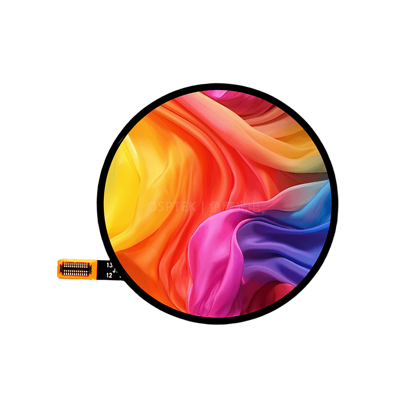

<p align="left"></p>

<h1 align="center">OSPTEK 1.73″ AMOLED Display 466×466 (AM173Q466466FLS)</h1>

<p align="center"><b>AMOLED module · QSPI · CO5300</b></p>

<p align="center"><a href="./README.md">简体中文</a> | English · <a href="../../README_EN.md">Family index</a></p>

<p align="center">
  
  
  
</p>

<p align="center"></p>

## Contents

- [Specifications](#specifications)
- [Resources](#resources)
- [Repository layout](#repository-layout)
- [Buy](#buy)
- [Support](#support)

---

## Specifications

| Item | Spec |
| ---- | ---- |
| Size | 1.73 inch |
| Type | AMOLED |
| Resolution | 466×466 |
| Outline | 48.50 x 48.50 mm |
| Active area | Φ43.76 mm |
| Interface | QSPI |
| Driver IC | CO5300 |
| Touch IC | CST820 |

> Full outline, FPC definition, power, and timing follow the product datasheet / driver IC datasheet.

## Resources

| Category | File |
| ---- | ---- |
| Datasheet | [`CO_5300_Datasheet_V0_00_20230328_07edb82936.pdf`](./datasheets/CO_5300_Datasheet_V0_00_20230328_07edb82936.pdf) |
| Datasheet | [`DS_CST_820_V1_2_e0543732ca.pdf`](./datasheets/DS_CST_820_V1_2_e0543732ca.pdf) |
| Datasheet | [`AM_173_Q466466_FLS_c3c39f821c.pdf`](./datasheets/AM_173_Q466466_FLS_c3c39f821c.pdf) |
| CAD file | [`OK-23GF024-04.pdf`](./cad/OK-23GF024-04.pdf) |
| Adapter materials | [`1.73寸AMOLED转接板原理图.png`](./adapter/1.73%E5%AF%B8AMOLED%E8%BD%AC%E6%8E%A5%E6%9D%BF%E5%8E%9F%E7%90%86%E5%9B%BE.png) |
| Adapter materials | [`PCB-1.73寸AMOLED屏QSPI转接板.pdf`](./adapter/PCB-1.73%E5%AF%B8AMOLED%E5%B1%8FQSPI%E8%BD%AC%E6%8E%A5%E6%9D%BF.pdf) |

## Repository layout

```text
display-amoled-1.73inch-466x466/ # repo root (nav: ../../README_EN.md; sample projects under root examples/)
└── versions/
    └── AM173Q466466FLS/        # full materials for this part number
        ├── README.md
        ├── README_EN.md
        ├── osptek.yml
        ├── images/
        ├── datasheets/       # product datasheet + driver/touch IC datasheets
        ├── cad/              # outline/cover CAD
        └── adapter/          # adapter board materials + photos
```

## Buy

See the [repo home page](../../README_EN.md#where-to-buy).

## Support

See the [repo home page](../../README_EN.md#support).

---

<p align="center"><sub>© 2026 OSPTEK · Materials in this repository are licensed under CC BY 4.0</sub></p>
